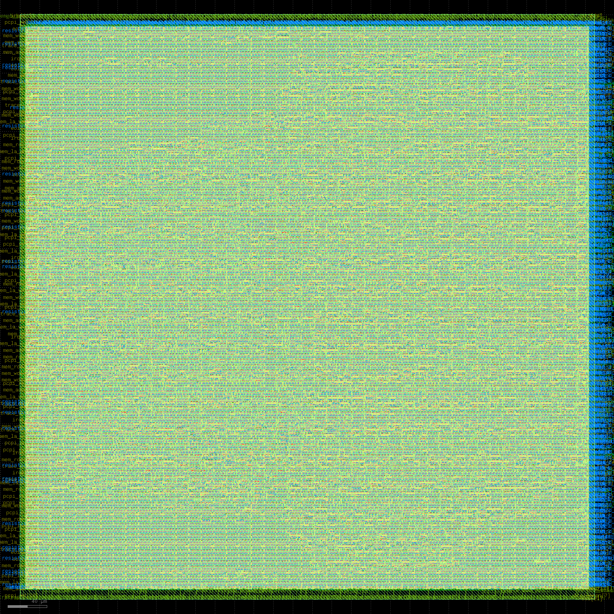
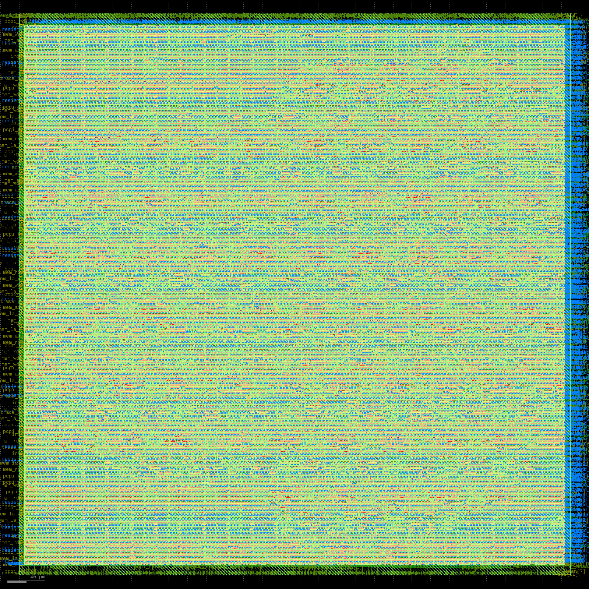

# PicoRV32 RISC-V Core — RTL-to-GDSII Physical Design (OpenLane / SKY130)

A complete ASIC physical design implementation of the open-source PicoRV32 RISC-V
CPU core, taken from RTL through to GDSII using the open-source OpenLane flow and
the SkyWater SKY130 process design kit — run twice, at two different target clock
frequencies, to explore real timing margin.

## Overview

| | |
|---|---|
| **Core** | [PicoRV32](https://github.com/YosysHQ/picorv32) — open-source RISC-V CPU (RTL from upstream) |
| **Flow** | OpenLane (Yosys synthesis → OpenROAD PnR → Magic/KLayout signoff) |
| **PDK** | SkyWater SKY130 (130nm), `sky130_fd_sc_hd` standard cells |
| **Synthesis cell count** | 9,406 standard cells |
| **Die area** | 0.354 mm² |
| **Core utilization** | 30.8% |
| **Synthesis strategy** | `AREA 0` (area-optimized) |

## Two runs, two target frequencies

Only `CLOCK_PERIOD` changed between runs — same RTL, same floorplan, same synthesis
strategy. Timing numbers below are from the signoff STA reports (typical corner).

| | Run 1 | Run 2 |
|---|---|---|
| Target clock | 50 MHz (20 ns period) | 100 MHz (10 ns period) |
| Worst setup slack | 10.10 ns | 3.02 ns |
| Worst hold slack | +0.33 ns | +0.27 ns |
| WNS / TNS | 0 / 0 | 0 / 0 |
| Worst-slack path | `resetn` → `mem_la_read` (input-to-output) | ALU adder carry chain → `alu_out[31]` (reg-to-reg) |
| Routing DRC / LVS errors | 0 / 0 | 0 / 0 |
| Antenna violations (pin / net) | 58 / 53 | 56 / 54 |
| Runtime | ~14.5 min | ~15.3 min |

Both runs met setup and hold timing with positive slack. Estimated maximum
frequency from the 100 MHz run: 1 / (10 − 3.02 ns) ≈ **143 MHz** at the typical
corner.

## Repository structure

```
├── src/
│   └── picorv32.v                  # PicoRV32 core RTL (from upstream)
├── config/
│   ├── config_50mhz.json           # OpenLane config, 50MHz target (CLOCK_PERIOD 20)
│   └── config_100mhz.json          # OpenLane config, 100MHz target (CLOCK_PERIOD 10)
├── layout/
│   ├── picorv32_layout_50mhz.png   # Final layout, 50MHz run
│   └── picorv32_layout_100mhz.png  # Final layout, 100MHz run
├── logs/
│   ├── metrics_50mhz.csv           # Full OpenLane metrics report, 50MHz run
│   └── metrics_100mhz.csv          # Full OpenLane metrics report, 100MHz run
└── README.md
```

## Flow stages completed (both runs)
- [x] RTL synthesis (Yosys) — 0 linter errors, 26 warnings (non-functional, e.g. unused signals)
- [x] Floorplanning, IO placement, tap/decap insertion, PDN generation
- [x] Global and detailed placement
- [x] Clock Tree Synthesis (CTS)
- [x] Global and detailed routing — 0 DRC violations
- [x] Multi-corner Static Timing Analysis (min/max/nominal) — setup and hold met
- [x] GDSII streamout (Magic + KLayout, cross-checked with 0 XOR differences)
- [x] DRC and LVS — clean
- [x] IR drop analysis (VPWR / VGND reports generated)
- [ ] Antenna — signoff still reports ~110 antenna violations per run (see Next steps)

## Final layouts

### 50 MHz run


### 100 MHz run


The two layouts look nearly identical — same die area and utilization were used
for both runs (only `CLOCK_PERIOD` changed), which was deliberate, to isolate the
effect of the clock target on timing alone rather than also varying the floorplan.

## What I learned: worst slack is not the same as the longest path

OpenLane's summary metrics reported a "critical path" of **1.65 ns** at 50 MHz and
**8.02 ns** at 100 MHz. That looked wrong — the synthesized netlist was identical in
both runs, so the logic couldn't have changed. Tracing both numbers back to the
signoff STA reports explained it.

**At 50 MHz, the worst-slack path was an I/O path, not a path inside the CPU.**
It ran from the `resetn` input through five cells to the `mem_la_read` output.
OpenLane's default constraints apply an input delay and an output delay of 20% of
the clock period each — 4 ns + 4 ns at a 20 ns period. That leaves an I/O path
only ~11.75 ns of budget, while a register-to-register path gets ~19.75 ns. So this
short path, with only 1.65 ns of actual logic (5.65 ns arrival − 4.00 ns input
delay), ended up with the least slack: 10.10 ns.

**At 100 MHz, the I/O delays shrank to 2 ns each, and the real core path became
the worst one.** The path runs from one flip-flop to another through the ALU's
32-bit adder, ending at `alu_out[31]`:

| Segment | Time |
|---|---|
| Clock tree (CTS insertion delay, 4 buffer levels) | 0 → 1.51 ns |
| Flop clock-to-Q | 1.51 → 1.97 ns |
| ALU logic (~25 stages, alternating AOI/OAI carry chain) | 1.97 → 8.02 ns |
| Setup slack | 3.02 ns |

The alternating `a21oi` / `o21ai` cells are a ripple carry chain: each bit waits for
the carry from the bit below, so the delay grows with the adder's width. This same
path existed in the 50 MHz run too, with roughly 13 ns of slack — it just wasn't the
worst path there.

**Takeaways**
- A summary metric reports whichever path has the worst slack, and that path can
  change when constraints change. Always trace a number back to the actual STA report.
- I/O paths and register-to-register paths should be reviewed as separate groups.
- The realistic ceiling for this implementation is ~143 MHz (typical corner), set by
  the ALU carry chain — not the ~600 MHz that the 1.65 ns number seemed to suggest.
- If more speed were needed, the first lever is synthesis: this design used an
  area-optimized strategy, and a delay-oriented strategy would choose a faster adder
  structure at some area cost — a direct power/performance/area trade-off.

Reported power also doubled from the 50 MHz to the 100 MHz run with an identical
netlist, consistent with dynamic power scaling linearly with frequency.

## Challenges and how I solved them

**Generating a layout preview image without a GUI.** OpenLane didn't auto-generate
a PNG preview of the final layout, and setting up X11 forwarding for a full KLayout
GUI session inside WSL/Docker looked like a real time sink. I used KLayout's
headless batch mode (`klayout -zz -r script.py`) instead, with a short Python script
using KLayout's own `pya` API to load the GDS and export an image directly — no GUI
or display server needed. The first attempt failed with an API mismatch error
(`load_layout` expects a file path string directly, not a pre-constructed `Layout`
object); checking KLayout's actual documented API resolved it.

**Choosing a safe first target frequency.** Rather than guessing at an aggressive
clock target and risking a failed run on a design this much larger than a simple
counter, I deliberately started conservative — 50MHz, 30% core utilization,
area-optimized synthesis — to get a clean baseline first. That baseline confirmed
the environment and design were sound before pushing the clock target further.

## Next steps
- Clear the remaining antenna violations by rerunning with heuristic diode
  insertion enabled (`RUN_HEURISTIC_DIODE_INSERTION`).
- Compare slack at the slow corner, not just typical, before quoting a final Fmax.
- Try a delay-oriented synthesis strategy and measure the area vs. timing trade-off
  on the ALU path.

## How to run

```bash
# Place picorv32.v under designs/picorv32/src/ in your OpenLane installation
# Copy config_50mhz.json or config_100mhz.json to designs/picorv32/config.json
cd OpenLane
make mount
./flow.tcl -design picorv32
```

## References
- PicoRV32: https://github.com/YosysHQ/picorv32
- OpenLane: https://github.com/The-OpenROAD-Project/OpenLane
- SKY130 PDK: https://github.com/google/skywater-pdk

## Author
Saurabh Manerikar — [LinkedIn](https://linkedin.com/in/saurabh-manerikar7b1815263)
